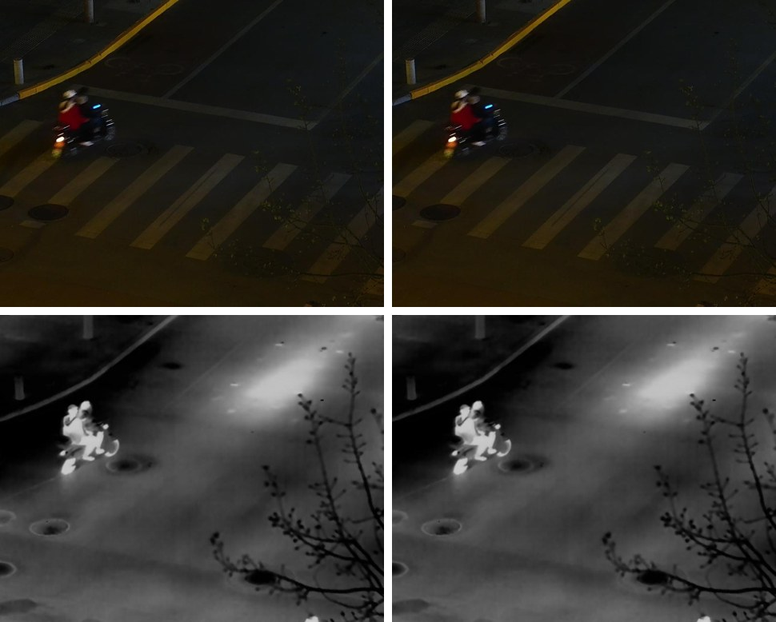

# SemanticRT – dataset mở rộng (slide 4b)

Dùng cho slide **4b**. Mục đích: có thêm một dataset **có nhãn phân đoạn** mà mô hình ghép chưa từng thấy, để kiểm tra cải tiến có tổng quát không (RQ3). Mọi số dưới đây là nhóm tự đếm trên dữ liệu tải về, trừ chỗ ghi "theo tác giả".

## 1. Vì sao chọn SemanticRT, không chọn LLVIP

| | LLVIP | SemanticRT |
|---|---|---|
| Nhãn | Khung bao người (1 lớp) | Nhãn từng pixel (13 lớp) |
| Đo được | mAP (phát hiện) | **mIoU**, giống FMB |
| Dùng được với cách chấm của nhóm? | Không | Có |

Theo README của tác giả, SemanticRT xây dựng chủ yếu từ LLVIP, thêm một ít từ OSU và INO. Vì vậy có thể coi nó là "LLVIP có nhãn phân đoạn" (không cần ghi điều này lên slide).

## 2. Thông tin cơ bản

- **Nguồn:** bài *SemanticRT* (ACM MM 2023), repo https://github.com/jiwei0921/SemanticRT
- **Tải:** Google Drive `SemanticRT_dataset.zip`, 2,9 GB (link trong README repo). Chỉ dùng cho nghiên cứu, không thương mại.
- **Cấu trúc:** `rgb/` (.jpg), `thermal/` (.jpg), `labels/` (.png 1 kênh), và `visual_color_GT/` (nhãn tô màu, **không phải ảnh**), kèm các file split .txt.

| Mục | Kết quả |
|---|---|
| Tổng | 11.371 cặp, cặp nào cũng đủ RGB + nhiệt + nhãn |
| Split gốc | train 6.830 / val 1.705 / test 2.836. Không trùng tên giữa các tập |
| Tập con của test | ngày 242, đêm 2.594, nhiều lớp 328, nhiều vật 170, khó 425 |
| Kích thước | Phần lớn 1280×1024. Khoảng 270 ảnh nhỏ hơn (328×254, 448×324, 512×384, 512×184), từ OSU/INO |
| Ảnh nhiệt | Lưu 3 kênh nhưng 3 kênh giống hệt nhau, nên đọc 1 kênh (giống FMB) |
| Rác trong zip | Thư mục `__MACOSX` và file `.DS_Store`, cần xóa trước khi chạy |

**13 lớp** (bảng màu theo README tác giả; tỉ lệ pixel và số ảnh do nhóm đếm):

| Mã | Lớp | % pixel | Số ảnh train / val / test |
|---|---|---|---|
| 0 | background (gồm cả mặt đường) | 78,73 | 6.830 / 1.705 / 2.836 |
| 1 | car stop (cột chắn) | 0,40 | 6.140 / 1.517 / 2.533 |
| 2 | bike | 0,54 | 3.512 / 868 / 1.428 |
| 3 | bicyclist | 0,43 | 2.471 / 584 / 1.000 |
| 4 | motorcycle | 0,70 | 3.135 / 767 / 1.278 |
| 5 | motorcyclist | 0,46 | 2.822 / 692 / 1.149 |
| 6 | car | 13,22 | 5.572 / 1.385 / 2.344 |
| 7 | tricycle | 0,34 | 447 / 103 / 171 |
| 8 | traffic light | 0,60 | 1.837 / 467 / 735 |
| 9 | box | 0,85 | 1.974 / 534 / 812 |
| 10 | pole | 0,75 | 4.697 / 1.165 / 1.979 |
| 11 | curve (mép lề đường) | 1,45 | 6.392 / 1.600 / 2.653 |
| 12 | person | 1,53 | 5.104 / 1.282 / 2.118 |

Lưu ý: bộ lớp **khác FMB**. Mặt đường nằm trong nền, nên không dùng lại SegFormer của FMB được, phải train SegFormer mới.

## 3. Phát hiện: split gốc bị rò nặng

**Cách kiểm**
1. Thử tìm ảnh liền số giữa train và test: ảnh liền số **không** giống nhau hơn hai ảnh bất kỳ → số thứ tự đã bị xáo khi đặt tên, nên không dò theo số được.
2. Vì vậy kiểm **theo nội dung**: thu nhỏ mỗi ảnh RGB về 40×32 xám, chuẩn hóa, rồi với mỗi ảnh test tìm ảnh train gần nhất.

**Kết quả**
- **347/2.836 ảnh test trùng y hệt một ảnh train** (khoảng cách < 0,01). Ví dụ test `img_10729` và train `img_00721`: chênh lệch từng pixel = 0 (ảnh này có trên slide 4b).


- Khoảng 59% ảnh test có một ảnh train gần như cùng khung (cùng cảnh, cùng góc máy, chỉ khác vài khoảnh khắc). Đã xem bằng mắt các cặp ví dụ.
- Val cũng bị y như vậy.

**Ý nghĩa:** split gốc chia **ngẫu nhiên theo từng khung hình**. Dùng nó thì mIoU sẽ bị thổi phồng. Đây là cùng loại lỗi với 7 ảnh rò ở FMB, nhưng nặng hơn nhiều.

## 4. Gom ảnh theo góc máy (để chia lại)

**Cách làm**
1. Đặc trưng **đường biên** (gradient Sobel trên ảnh xám đã làm mờ, 48×40), vì đặc trưng này ít đổi giữa ngày và đêm.
2. Nối mỗi ảnh với 10 ảnh gần nhất nếu đủ giống → được 35 cụm. Ảnh lẻ gán vào cụm gần nhất.
3. Lấy ảnh trung bình mỗi cụm để xóa xe và người di chuyển, rồi gộp các cụm có nền giống nhau → còn 28.
4. Xem bằng mắt, gộp thêm 4 nhóm rõ ràng cùng camera → còn **khoảng 22 góc máy** (góc lớn nhất 1.626 ảnh, nhỏ nhất 35 ảnh).

**Kết quả:** góc máy nào cũng có ảnh ở cả train, val và test gốc, tỉ lệ gần 60/15/25 → xác nhận split gốc chia ngẫu nhiên.

**Hạn chế**
- Bước 4 gộp bằng mắt, chưa xem hết từng cụm. Thực tế có thể ít hơn 22 góc máy, vì cảnh ngày và đêm của cùng một camera có thể chưa được gộp. Vì vậy slide ghi "~22".
- Trước khi chia thật, cần xem lại ảnh đại diện của từng góc máy ([`hinh/goc_may_dai_dien.jpg`](hinh/goc_may_dai_dien.jpg), ảnh trung bình của mỗi góc máy).

## 5. Cách dùng trong đồ án (chưa làm, chờ nhóm chốt)

- **Chia lại theo góc máy:** chọn vài góc máy làm test (khoảng 2.000–2.500 ảnh), còn lại làm train. Test phải có đủ ảnh ngày/đêm và đủ lớp. Có thể lấy tập con để chạy kịp trên Kaggle. Kiểm như manifest FMB: giao các tập rỗng, mọi file tồn tại, không id trùng.
- **Mô hình ghép giữ nguyên** (SAGE gốc và bản fine-tune trên FMB), không train lại trên SemanticRT.
- **Mức 1:** chỉ số ghép (không cần nhãn, không cần train).
- **Mức 2:** train SegFormer-B3 mới trên ảnh ghép tập train (đã chia theo góc máy), chấm mIoU trên test. Làm như nhau cho VIS / IR / Ghép TB / SAGE / bản cải tiến.
- Bài SAGE không báo số trên SemanticRT, nên mọi số là "nhóm tự đo".

## 6. File và chạy lại

| Script ([`scripts/`](scripts/)) | Làm gì | Ra file |
|---|---|---|
| `kiem_semanticrt.py` | Đếm split, kích thước, kênh, tỉ lệ lớp | [`ket_qua/semanticrt_tom_tat.json`](ket_qua/semanticrt_tom_tat.json) |
| `kiem_ro_semanticrt.py` | Kiểm ảnh liền số (cho thấy số đã bị xáo) | `ro_vi_du/` |
| `kiem_ro_noidung.py` | Tìm ảnh train gần nhất cho mỗi ảnh test | `semanticrt_test_gan_nhat.json`, `ro_noidung/` |
| `gom_canh_v2.py` | Gom cụm theo đường biên | `semanticrt_canh.json` |
| `gop_cum.py` | Gộp cụm theo ảnh trung bình | [`ket_qua/semanticrt_may.json`](ket_qua/semanticrt_may.json) (cột `may` = góc máy của từng ảnh) |

Cách chạy: giải nén dataset vào `semanticrt/SemanticRT_dataset`, xóa `__MACOSX` và `.DS_Store`, rồi trong thư mục chứa nó chạy lần lượt, ví dụ:

```bash
python scripts/kiem_semanticrt.py semanticrt/SemanticRT_dataset
python scripts/kiem_ro_noidung.py semanticrt/SemanticRT_dataset
python scripts/gom_canh_v2.py semanticrt/SemanticRT_dataset
python scripts/gop_cum.py semanticrt/SemanticRT_dataset
```

Cần `numpy`, `Pillow`. Chạy trên CPU, ít RAM, mỗi script vài phút. Script ghi file ra thư mục đang đứng.

Bước gộp bằng mắt (4 nhóm) đã ghi trong `ket_qua/semanticrt_may.json`, trường `gop_bang_mat`. Lưu ý: chạy lại `gop_cum.py` sẽ ghi đè file này và mất bước gộp bằng mắt, phải gộp lại theo danh sách đó.
